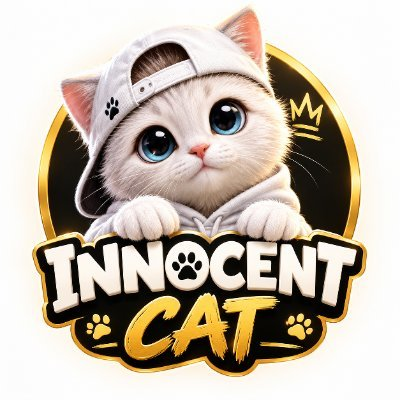

# Innocent Cat ($ICAT)

> Innocence with a Purpose.

A community-driven cat token built around innocence, community, and a long-term vision for charitable impact (orphanages and vulnerable people).

## Token facts

| Parameter        | Value                                        |
| ---------------- | -------------------------------------------- |
| Name / Ticker    | Innocent Cat / $ICAT                         |
| Total supply     | 100,000,000 ICAT                             |
| Buy tax          | 3%                                           |
| Sell tax         | 3%                                           |
| Contract address | `0x6AA64e5215Fc7a9182f26d5c55C21Ce0863049fF` |
| Network          | BNB Smart Chain (BSC)                        |

## Official links

- X (Twitter): https://x.com/Innocentcat224
- Telegram: https://t.me/inncat
- Buy: https://pancakeswap.finance/swap?chain=bsc&outputCurrency=0x6AA64e5215Fc7a9182f26d5c55C21Ce0863049fF
- Chart: https://dexscreener.com/bsc/0x6AA64e5215Fc7a9182f26d5c55C21Ce0863049fF
- Explorer: https://bscscan.com/token/0x6AA64e5215Fc7a9182f26d5c55C21Ce0863049fF

## Website

Static site, no build step: `index.html`, `styles.css`, `app.js`. Live at https://innocentcat.vercel.app (Vercel redeploys on every push).

- Design: black-and-gold badge look from the logo, alternating with cream, sky and starry-night panels.
- Motion (`app.js`): GSAP + ScrollTrigger and Lenis smooth scroll, loaded from cdnjs/unpkg. Panels rise in as cards and unfold while scrolling, hero intro and parallax, scroll-speed marquee ribbons, counters, a pinned roadmap where the rocket cat flies across the phases (vertical on phones), and a confetti burst on the community section. Everything is skipped for visitors who prefer reduced motion.
- The contract address is set once in the `ICAT` object at the top of `app.js`; the PancakeSwap, DexScreener and BscScan links are built from it. Any `<a data-link="buy|chart|explorer">` gets the matching URL.
- Artwork: generated with Higgsfield from the logo. `assets/remote-images.json` lists the source URLs; the `Fetch generated images` GitHub Action downloads them, converts them to WebP and commits them to `assets/img/`. To add art, add an entry there and push.

## Project materials

- `docs/innocent-cat-whitepaper.pdf`: white paper v1.0 (October 2026, 8 pages)
- `docs/innocent-cat-whitepaper.txt`: plain-text extract of the white paper
- `assets/logo.jpg`: official logo
- `assets/whitepaper-tax-structure.jpg`: screenshot of white paper section 9 (Tax Structure)

## Roadmap (from white paper)

1. **Launch & Foundation**: token launch, community, branding, social channels
2. **Community Growth**: campaigns, content, X Spaces, partnerships
3. **Ecosystem Development**: digital/community utilities, partnerships
4. **Charity Activation**: structured initiatives, starting with orphanage support
5. **Long-Term Expansion**: scale the community and social-impact programs

## Content guidelines (from white paper)

- No tax allocation breakdown is confirmed. Don't claim any percentage goes to liquidity, marketing, charity, etc.
- No vesting, burn, staking or treasury figures are confirmed.
- Charity is a project objective, not a contractual entitlement.
- No guaranteed returns or profit promises.
